[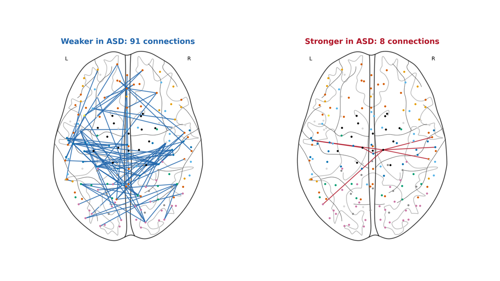](images/cover.png)

*The brain connections that differ in autism, seen from above. Part 2 explains what they are.*

## Why I did this project

I noticed that autistic people often think and respond to the world differently from other people, and I wondered what is different inside their brains. I also wanted to know whether AI could find that difference in brain scans.

That led to two questions:

1. **Can brain connectivity tell autistic people (ASD) from non-autistic people (controls) in a hospital the model has never seen?**
2. **If it can, which brain connections carry the signal?**

Part 1 of this post answers the first question, and Part 2 the second. The full code and every detail are in two notebooks, linked at the end. Click any figure to open it at full size.

---

# Part 1: Can a model recognise autism in a hospital it has never seen?

## The problem

Autism is diagnosed by observing behaviour. There is no brain test for it. Many studies have trained AI models on brain scans and reported very high accuracy, but there is a catch.

Every hospital uses its own scanner and settings, so scans from the same hospital look alike. Hospitals also recruit different proportions of autistic people. If a model is trained and tested on people from the same hospitals, it can learn to recognise the hospital and guess from its proportion, instead of learning anything about the brain. It is like a cat-versus-dog classifier that learns the background of the photos instead of the animals.

When models are tested on hospitals they have never seen, results drop. The best published result I found on this dataset was 66.8% accuracy (Abraham et al., 2017).

## Why brain connectivity

Autism affects many abilities at once: social understanding, the senses, movement and language. All of these need many brain regions to work together, so instead of looking at one region at a time, I looked at how regions communicate.

**Functional connectivity** measures how much the activity of two brain regions rises and falls together over time. It does not mean a physical wire between them, only that they tend to be active at the same time.

## The data

I used **ABIDE I** (Autism Brain Imaging Data Exchange), a public dataset that combines scans from many research sites. After quality checks and removing very short scans, I had:

* **846 people:** 391 autistic and 455 controls, from children to adults (median age about 15). Most are male: only 54 autistic participants and 90 controls are female.
* **19 sites** (hospitals or separate scan batches)
* **Resting-state fMRI:** each person lay still in the scanner without doing any task, while the scanner recorded brain activity every 1.5 to 3 seconds, for about 5 to 10 minutes. Each recording is called a *time point*.

The scans were already cleaned by the Preprocessed Connectomes Project (correction for head movement, removal of noise signals, filtering), and the brain was divided into **200 regions** using the CC200 atlas.

[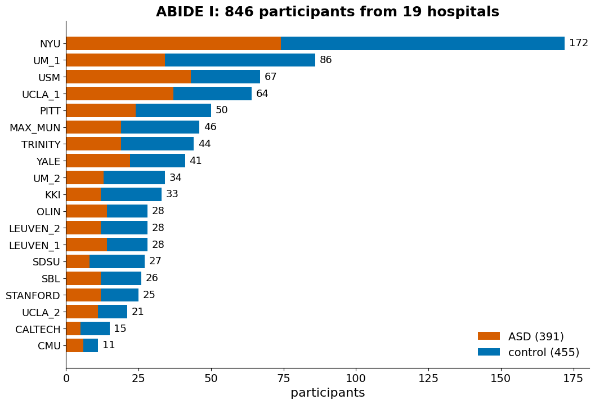](images/01_data_sites.png)

*Participants per site. The proportion of autistic participants differs between sites, which is exactly what a model could exploit as a shortcut.*

## From brain scan to prediction

Each person goes through the same five steps.

[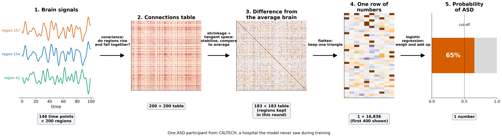](images/02_pipeline.png)

1. **Brain signals.** Each of the 200 regions has a signal over time.
2. **Connections table.** For every pair of regions, I measured how much their signals rise and fall together (the *covariance*). A high value means the two regions work together; a value near zero means they are unrelated. This gives a table of connections for each person. (A few regions had no signal in some scans, so they are removed before the next step, leaving about 180.)
3. **Difference from the average brain.** Each person's table is compared with the average table of the people the model is trained on. Each number now says how much stronger or weaker that connection is than average. This method, called *tangent space*, performed best in large comparisons of methods (Abraham et al., 2017; Dadi et al., 2019).
4. **One row of numbers.** The table is a mirror image of itself, so only one half is kept: about 16,000 numbers per person.
5. **Prediction.** A logistic regression model gives each number a weight, adds everything up and turns the total into a probability of autism. Above 50% means the model predicts autism.

The figure below shows step 2 on a small example with three regions: A and B move together, so their value is high, while C moves against them, so its values are negative.

[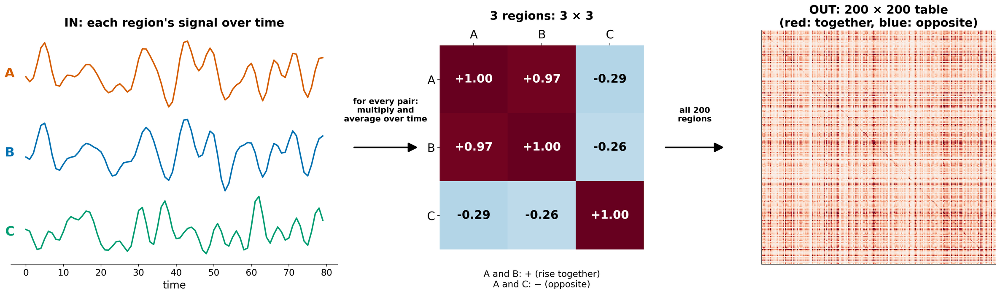](images/03_covariance.png)

I used a simple model instead of deep learning because there are about 16,000 numbers per person but only about 800 people to learn from. A simple model is less likely to memorise noise, and it is easier to check what it has learned.

## A problem I found, and my fix

Between steps 2 and 3, there is a hidden problem.

Many scans are short. About half of the participants have fewer time points than there are brain regions. When that happens, the connections table has some *directions* with no spread at all. In fact, every one of the 846 tables had at least one such direction, because cleaning the scans also removes some of the variation. Step 3 uses a logarithm, and the logarithm of zero cannot be calculated, so these tables break the next step.

The standard fix is called **shrinkage**: blend each person's table with a plain table that has no connections. This lifts the near-zero spreads above zero while keeping the overall pattern. The papers I followed use a version called **Ledoit-Wolf**, which decides how much to blend from each person's own data. I tried it first and reached a balanced accuracy of 0.67.

When I looked closer, Ledoit-Wolf blended at most 14%, and it treated short and long scans very differently. After blending, the ratio between the largest and smallest spread still ranged from 179 to more than 6,600 depending on the person.

So I changed how much to blend: each table is blended until its largest spread is **exactly 100 times** its smallest. Every person's table then becomes equally stable, whatever the length of their scan.

[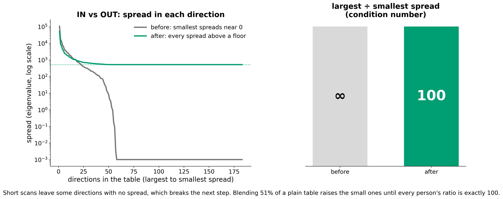](images/04_shrinkage.png)

*Grey: before shrinkage, many directions have almost no spread. Green: after shrinkage, every direction has a minimum spread, and the ratio of largest to smallest is 100.*

This raised AUC from 0.72 to 0.75, an improvement that was clearly above zero when I tested it (95% interval 0.014 to 0.043). Balanced accuracy went from 0.67 to 0.69, but that difference was less certain. Limiting this ratio is an existing idea in statistics; what I did was notice that the standard method was not enough for short scans and apply it here.

## Testing fairly: leave one site out

To test on hospitals the model has never seen, I used **leave-one-site-out** cross-validation:

* train the model on 18 sites
* test it on the 19th site
* repeat 19 times, so that every site is tested once by a model that never saw it

Every setting of the model was also chosen using the 18 training sites only, so the test site never influenced anything.

[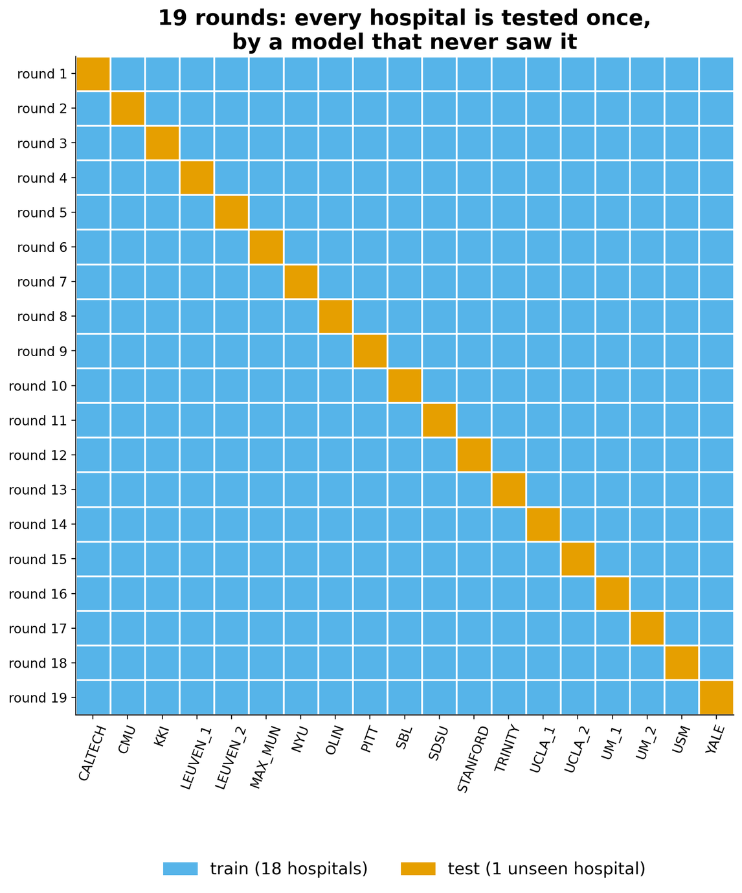{: width="460"}](images/05_leave_one_site_out.png)

I measured two things:

* **Balanced accuracy:** the average of how many autistic people and how many controls are classified correctly. Guessing gives 0.5, whatever the group sizes.
* **AUC:** pick one autistic and one non-autistic person at random; AUC is the chance that the model gives the autistic person the higher score. Guessing gives 0.5, and a perfect model gives 1.

## Results

**On sites the model had never seen, it reached a balanced accuracy of 0.69 and an AUC of 0.75.** In other words, given one autistic and one non-autistic person from a new hospital, the model ranks them correctly about three times out of four. It correctly identified 65% of autistic participants and 73% of controls.

[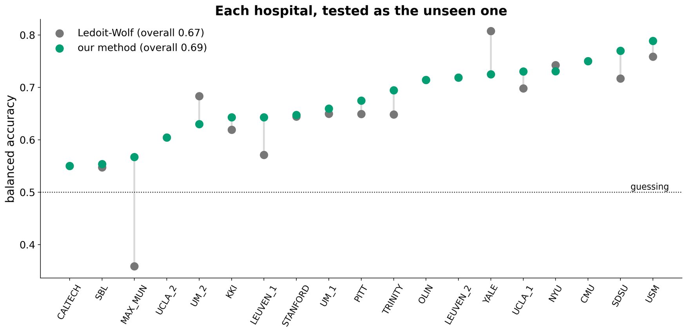](images/06_results_per_site.png)

*Each dot is one site tested as the unseen site. With my method (green), every site is above 0.5. With Ledoit-Wolf (grey), one site falls below 0.5.*

With my method, every site scored above 0.5. The biggest change was at MAX_MUN, one of the sites with the shortest scans, which went from 0.36 to 0.57. Not every site improved, though: YALE, for example, went from 0.81 to 0.73.

**Was it luck?** I shuffled the diagnoses within each site 500 times and repeated the whole test each time. Shuffling breaks the link between brains and diagnoses, so these runs show what chance looks like. None of the 500 shuffled runs came close to the real result (p = 0.002, the smallest value possible with 500 runs).

[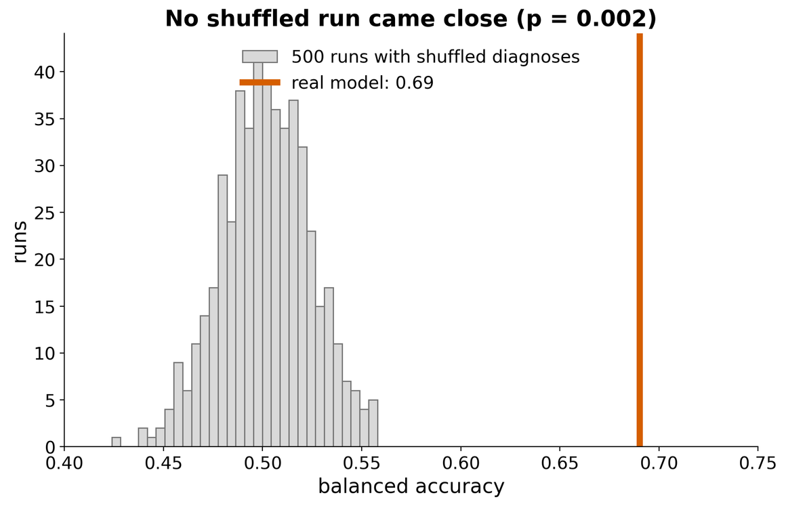{: width="560"}](images/07_permutation_test.png)

## Is it just head motion?

Head movement in the scanner is a well-known problem in fMRI: even tiny movements change the measured connections. Autistic participants in this dataset moved more on average (38% more), so the model could have learned to detect movement instead of brain differences. I checked this in two ways.

[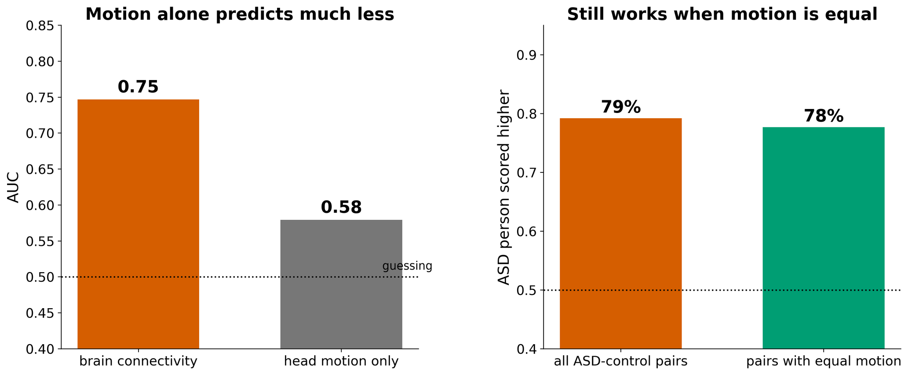](images/08_head_motion.png)

* **Left:** a model using only head motion reached an AUC of 0.58, far below 0.75.
* **Right:** I paired autistic and control participants from the same site who moved almost exactly the same amount. The model still ranked 78% of these pairs correctly, almost the same as for all pairs (79%).

So motion does not explain the result. It is not completely gone, though: people who moved more still get slightly more autism-like scores, which I list as a limitation.

---

# Part 2: Where in the brain is the signal?

The model works, but which connections does it rely on? With about 16,000 connections, some will differ between the groups just by chance, so I needed a way to separate real differences from lucky ones.

## Find in one set of hospitals, confirm in another

I split the 19 sites into two halves:

* **Half A** (8 sites, 414 people): search for connections that differ between autistic people and controls, holding site, age, sex and head motion fixed
* **Half B** (11 different sites, 432 people): test the candidates once

The list of candidates was saved and frozen before half B was analysed, so I could not pick results after seeing the new data.

[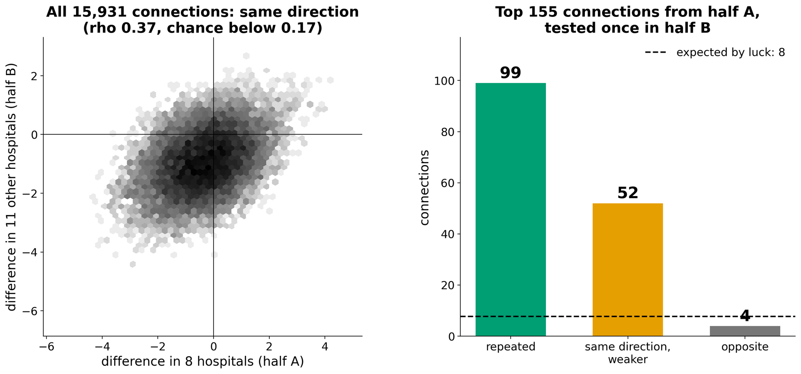](images/09_replication.png)

* **Left:** across all 15,931 connections, the differences in half A and half B point the same way (correlation 0.37, while 95% of runs with shuffled labels stayed below 0.17).
* **Right:** of the 155 strongest connections from half A, **99 repeated** in the new hospitals. By luck alone, about 8 would (5% of 155). Only 4 went the opposite way.

This is the strongest result of the project: found in one set of hospitals, confirmed in a completely separate set.

## Which connections differ

Of the 99 confirmed connections, **91 are weaker in autism** and only 8 are stronger.

[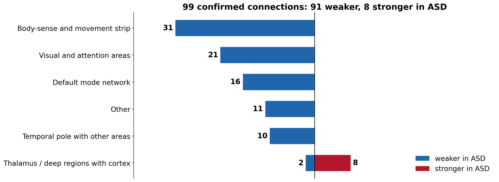](images/10_connection_groups.png)

[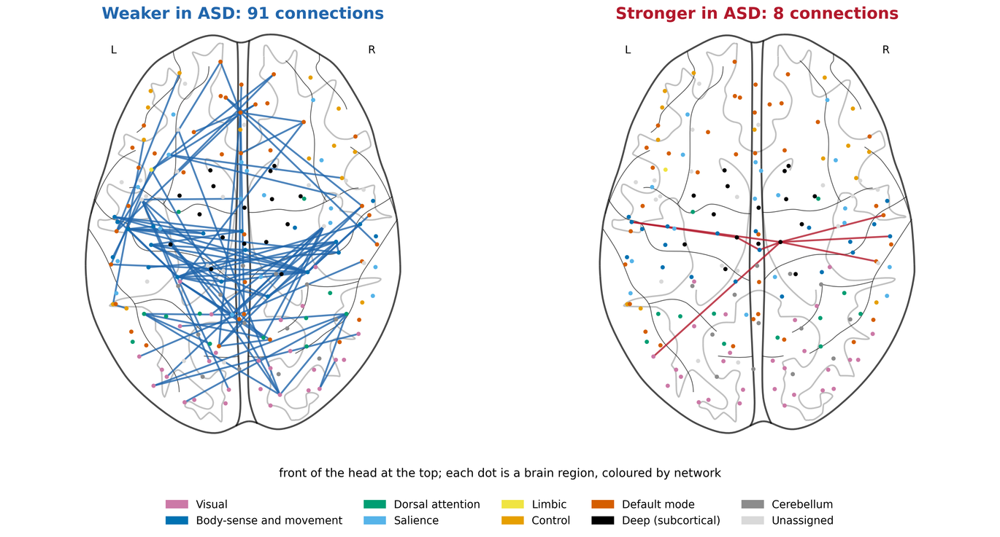](images/11_brain_maps.png)

In plain words:

* **Within the body-sense and movement strip (31 connections, weaker).** The precentral gyrus controls movement, and the postcentral gyrus processes touch and body position. They form a strip across the top of the brain. These regions were less connected with each other, including between the left and right sides. This was the clearest finding in both halves.
* **Visual and attention areas (21, weaker).** Connections involving regions at the back of the brain that process vision, and regions that direct attention.
* **Within the default mode network (16, weaker).** This network is most active when we are at rest and thinking about ourselves and other people. Its front and back parts were less connected with each other.
* **Temporal pole with other areas (10, weaker).** The temporal pole, at the front tip of the temporal lobe, links emotion with social knowledge. It was less connected with the rest of the brain, especially the default mode network and visual areas.
* **Thalamus with the cortex (8, stronger).** The thalamus sits deep in the centre of the brain and relays sensory information to the cortex. These were the only connections that were stronger in autism. They repeated less strongly than the others and are the connections most affected by head motion, so I treat them as a lead rather than a firm result.

These areas are linked to the senses, movement and social thinking, which often differ in autism. But the data only shows *where* the groups differ, not *why*, or whether these differences cause autistic traits.

The results fit earlier large studies of the same dataset, which also reported mostly weaker connections between cortical areas in autism, together with stronger connections between deep brain structures and sensory and movement areas (Di Martino et al., 2014; Cerliani et al., 2015).

The model's own weights point to the same systems: the connections it relies on most involve the thalamus and the postcentral gyrus.

## Is the pattern shared, or carried by a few people?

[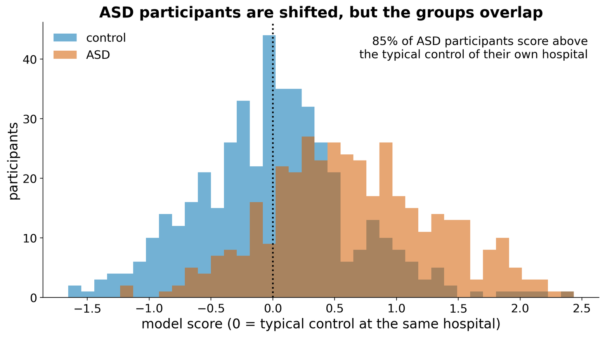](images/12_shared_pattern.png)

Each person's model score was compared with the typical control at their own site (0 on the graph). **85% of autistic participants scored above it**, so the pattern is spread across most autistic people, not carried by a small subgroup. Autistic participants were also slightly more similar to each other than to controls.

But the two groups still overlap a lot. Each single connection differs only a little between the groups; the model works by combining thousands of small differences. That is why it **cannot diagnose an individual person**.

## Does it follow autism severity?

[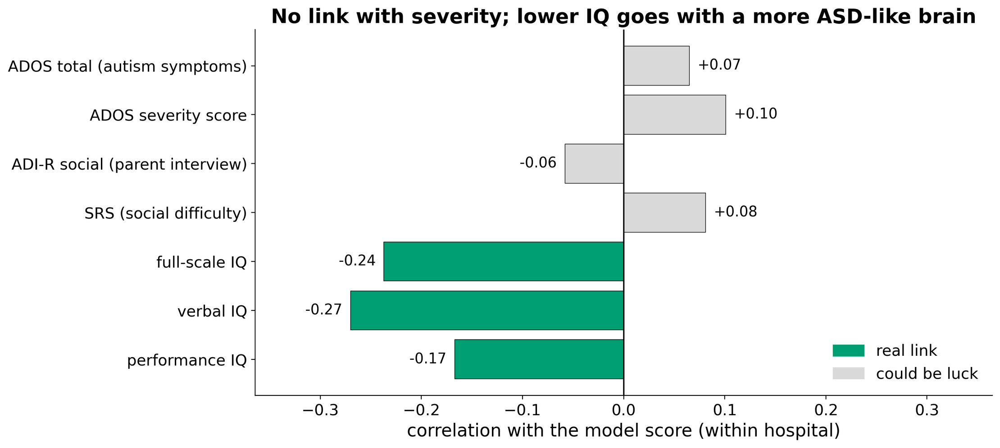](images/13_symptoms_iq.png)

No. The model score was barely related to standard autism symptom scores (ADOS, ADI-R and SRS). It did go with **lower IQ among autistic participants** (verbal IQ correlation -0.27), but not among controls. So the connectivity difference marks the diagnosis group rather than how severe someone's symptoms are, and part of it may be related to IQ. These data cannot separate the two.

---

## What did not work

I also tried other ideas. None of them clearly beat the final model: the differences were either worse or too small to be sure of.

| What I tried | Balanced accuracy | AUC |
|---|---|---|
| Final model | 0.691 | 0.747 |
| Ledoit-Wolf shrinkage (the standard method) | 0.670 | 0.718 |
| Five other brain atlases | 0.609 to 0.685 | 0.659 to 0.747 |
| Average of six atlases | 0.680 | 0.758 |
| A separate average brain for each site (needs data from the new site first) | 0.694 | 0.758 |
| Graph measures (how connected and central each region is) | 0.580 | 0.620 |
| Global signal regression (removing the whole-brain average signal) | 0.680 | 0.735 |

Summarising each region's connections into a few numbers, as graph measures do, lost most of the signal. The information seems to be spread over many individual connections.

## Limitations

* **The groups overlap.** About three in ten people are misclassified, so this is a group-level finding, not a diagnostic test.
* **The shrinkage target was compared on the same sites I report.** I tried targets of 30 and 100, which gave the same balanced accuracy, so the effect is probably small, but the result may be slightly optimistic.
* **Head motion still has a small effect** on the model's scores, even though it does not explain the result.
* **Some sites come from the same institution** (for example UCLA_1 and UCLA_2), so for those the test site is slightly less "unseen".
* **Mostly male participants, and only one dataset.** Results for females are less certain, and the findings still need to be tested on an independent dataset such as ABIDE II.

## What I learned

* **A high number is easy; an honest number is hard.** Testing on unseen hospitals, checking for leaks and comparing against shuffled labels made my results lower, but believable.
* **Check every step that learns from data.** My first model decided which brain regions to keep using all 846 people, including the test sites. It was a small leak, and I fixed it by deciding from the training sites only.
* **Look inside the method.** The shrinkage fix only came from looking at what Ledoit-Wolf actually did to short scans instead of treating it as a black box.
* **Negative results are results.** Most of the ideas I tried did not help, and that tells me the signal is spread across many connections rather than hidden in one clever feature.
* **Find and confirm in separate data.** Searching in one half and testing once in the other was the only way to be sure the brain differences were not luck.

## Code and notebooks

* [Model notebook]({{ site.github.repository_url }}/blob/main/FINAL_ABIDE_ASD_connectivity_pipeline.ipynb): the full pipeline, results and validity checks
* [Findings notebook]({{ site.github.repository_url }}/blob/main/FINAL_ABIDE_EDA.ipynb): which brain connections differ and how sure we can be

## References

* Abraham, A., Milham, M. P., Di Martino, A., Craddock, R. C., Samaras, D., Thirion, B., & Varoquaux, G. (2017). Deriving reproducible biomarkers from multi-site resting-state data: an autism-based example. *NeuroImage*, 147, 736-745. [https://doi.org/10.1016/j.neuroimage.2016.10.045](https://doi.org/10.1016/j.neuroimage.2016.10.045)
* Cerliani, L., Mennes, M., Thomas, R. M., Di Martino, A., Thioux, M., & Keysers, C. (2015). Increased functional connectivity between subcortical and cortical resting-state networks in autism spectrum disorder. *JAMA Psychiatry*, 72(8), 767-777. [https://doi.org/10.1001/jamapsychiatry.2015.0101](https://doi.org/10.1001/jamapsychiatry.2015.0101)
* Dadi, K., Rahim, M., Abraham, A., Chyzhyk, D., Milham, M., Thirion, B., & Varoquaux, G. (2019). Benchmarking functional connectome-based predictive models for resting-state fMRI. *NeuroImage*, 192, 115-134. [https://doi.org/10.1016/j.neuroimage.2019.02.062](https://doi.org/10.1016/j.neuroimage.2019.02.062)
* Di Martino, A., Yan, C.-G., Li, Q., et al. (2014). The autism brain imaging data exchange: towards a large-scale evaluation of the intrinsic brain architecture in autism. *Molecular Psychiatry*, 19(6), 659-667. [https://doi.org/10.1038/mp.2013.78](https://doi.org/10.1038/mp.2013.78)
* Ledoit, O., & Wolf, M. (2004). A well-conditioned estimator for large-dimensional covariance matrices. *Journal of Multivariate Analysis*, 88(2), 365-411. [https://doi.org/10.1016/S0047-259X(03)00096-4](https://doi.org/10.1016/S0047-259X(03)00096-4)

The full reference list is in the notebooks.

## Acknowledgements

This project was done in BrainCode 101. Thank you to my mentors and TAs for their guidance and feedback, and to the ABIDE consortium and the Preprocessed Connectomes Project for sharing their data.
